

# Educhronos — Manual de uso

**versión 0.5.0** · 20 de octubre de 2026

Para la secretaria del centro y para quien instale Educhronos en el ordenador del centro. Explica,
tarea por tarea, cómo preparar el curso, generar el horario, ajustarlo y sacarlo en papel.

Cómo leerlo: los textos que ves en la pantalla van entre comillas, como «Generar horario». En las
capturas, los nombres del profesorado aparecen tapados en gris.

# 1. Antes de empezar: lo que no tiene vuelta

Cuatro cosas de Educhronos no se pueden deshacer. Léelas antes de empezar a trabajar.

1. **Generar el horario fija las clases y la jornada de ese curso.** Después de generar, ya no
   puedes cambiar sus clases ni su jornada. Genera cuando la configuración esté terminada. Lo
   explica la sección 9, y la 11 dice qué hacer si aun así tienes que cambiar algo.
2. **Duplicar un curso deja el curso de partida en solo lectura.** Podrás abrirlo para consultarlo,
   pero no cambiarlo. Lo explica la sección 5.
3. **Los cursos no se borran.** Educhronos no tiene ninguna forma de borrar un curso. Cada vez que
   duplicas, el curso de partida se queda en la lista. Lo explican las secciones 5 y 11.
4. **Dar de baja a un profesor que tiene clases son dos pasos.** Primero pasas sus clases a otro
   profesor; después lo borras. Si solo haces el primero, sigue en la lista. Lo explica la
   sección 6.

# 2. Instalar Educhronos, y actualizarlo a una versión nueva

**Para qué sirve.** Para dejar Educhronos en el ordenador del centro, con los datos de partida, sin
permisos de administrador y sin escribir órdenes.

**Qué necesitas.** El USB del centro. Abajo se dice qué tiene que llevar.

## Instalar por primera vez

**Antes de empezar, comprueba el USB.** Ábrelo. Nada más abrirlo, sin entrar en ninguna carpeta,
tienes que ver estos cuatro elementos:

- `Educhronos-win.zip`: el programa. El Explorador puede enseñarlo solo como `Educhronos-win`, con
  un icono de carpeta con cremallera.
- `Educhronos-win.zip.sha256`: sirve para comprobar el zip; no tienes que hacer nada con él.
- La carpeta `base-partida`: dentro lleva un único fichero terminado en `.db` (y otro que acaba en
  `.md5`, que no se toca).
- `Educhronos-manual-0.5.0.pdf`: este manual.

Si falta alguno, no sigas: avisa. Si hay otras carpetas, no las uses.

1. Abre el USB y copia `Educhronos-win.zip` a una carpeta del ordenador, por ejemplo Documentos.
2. Abre la carpeta donde lo has copiado. Haz clic con el botón derecho sobre **esa copia** del zip,
   no sobre la del USB, y elige <!-- sin-comprobar -->«Extraer todo»<!-- /sin-comprobar -->; en la ventana que sale, pulsa
   <!-- sin-comprobar -->«Extraer»<!-- /sin-comprobar -->. Dentro de la carpeta extraída hay una carpeta `Educhronos` con un
   fichero `Instalar.cmd` (el Explorador puede enseñarlo solo como `Instalar`).
3. Antes del paso 4, copia la carpeta `base-partida` del USB **dentro** de esa carpeta
   `Educhronos`, junto a `Instalar.cmd`.
4. Haz doble clic en `Instalar.cmd`. Se abre una ventana negra que va diciendo cada paso y, al final,
   espera a que pulses una tecla. No la cierres sin leerla.

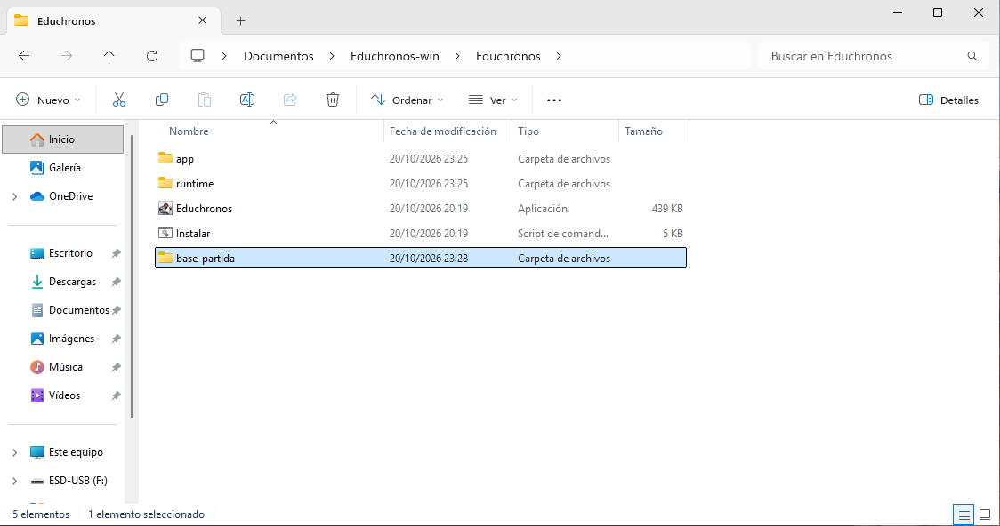

**Qué ves al terminar.** La ventana tiene que decir, en este orden:

<!-- sin-comprobar -->
- «[1/3] Programa en …»
- «[2/3] Acceso directo en el Escritorio»
- «[3/3] Base de partida»
- «Base de partida copiada a …»
- «Educhronos instalado en …»
- «Abre Educhronos con el acceso directo del Escritorio.»
<!-- /sin-comprobar -->

Pulsa una tecla y la ventana se cierra. En el Escritorio queda un acceso directo llamado
`Educhronos`.

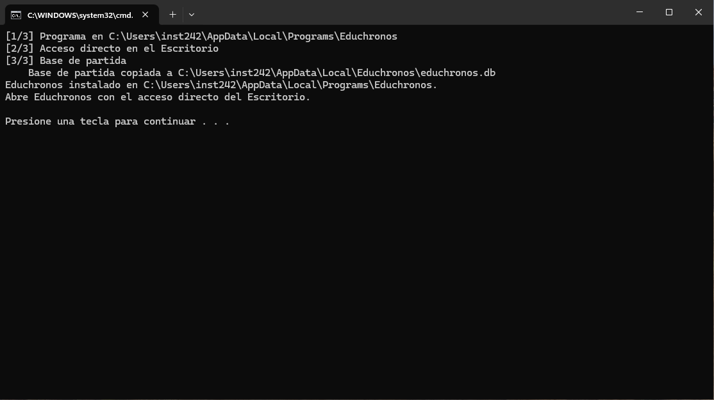

**Atención:** si en lugar de <!-- sin-comprobar -->«Base de partida copiada a …»<!-- /sin-comprobar --> la ventana dice
<!-- sin-comprobar -->«No hay base de partida junto a Instalar.cmd: la carpeta de datos no se toca.»<!-- /sin-comprobar -->,
**no abras Educhronos todavía**. Copia la carpeta `base-partida` junto a `Instalar.cmd`, como en el
paso 3, y vuelve a hacer doble clic en `Instalar.cmd`. Mientras no hayas abierto Educhronos, la
carpeta de datos sigue vacía y la base se copia.

Otros avisos que puede dar la ventana:

<!-- sin-comprobar -->
- «ABORTA: Educhronos esta abierto. Cierralo desde el icono de la bandeja (Salir) y vuelve a lanzar Instalar.cmd.»
  Cierra Educhronos como dice la sección 3 y vuelve a empezar por el paso 4.
- «ABORTA: Instalar.cmd tiene que estar junto a Educhronos.exe, app y runtime.» Has lanzado
  `Instalar.cmd` sin extraer antes el zip, o desde otra carpeta. Vuelve al paso 2.
- «Hay 2 ficheros .db en base-partida: no se copia ninguno.» (o con otro número). En la carpeta
  `base-partida` tiene que haber un único fichero `.db`.
<!-- /sin-comprobar -->

## Actualizar a una versión nueva

1. Cierra Educhronos (sección 3).
2. Haz una copia de seguridad de tus datos: copia entera la carpeta `%LOCALAPPDATA%\Educhronos` a
   otro sitio, por ejemplo a un USB. La última sección, *Si algo no va bien*, dice cómo abrirla.
3. Repite los pasos 1, 2 y 4 de la instalación con el zip nuevo. Esta vez no hace falta la carpeta
   `base-partida`.

**Qué ves al terminar.** La ventana dice
<!-- sin-comprobar -->«La carpeta de datos ya tiene 1 ficheros .db: no se copia la base de partida.»<!-- /sin-comprobar -->
(o con otro número) o <!-- sin-comprobar -->«No hay base de partida junto a Instalar.cmd: la carpeta de datos no se toca.»<!-- /sin-comprobar -->
Las dos son normales al actualizar: tus datos no se tocan. Al abrir Educhronos, la línea de versión
(sección 3) dice la versión nueva.

**Atención:** una actualización no tiene vuelta atrás. Cuando la versión nueva abre tus cursos, la
versión anterior ya no puede abrirlos. Por eso la copia del paso 2.

# 3. Abrir y cerrar Educhronos, y ver qué versión tienes

**Para qué sirve.** Para empezar y terminar de trabajar, y para saber qué versión tienes si tienes
que avisar de un fallo.

## Abrir

1. Haz doble clic en el acceso directo `Educhronos` del Escritorio.
2. Sale una ventana pequeña que dice
   <!-- sin-comprobar -->«Educhronos se está iniciando…» y «El navegador se abrirá en unos segundos.»<!-- /sin-comprobar -->
   Se cierra sola cuando se abre el navegador, o al minuto.
3. El navegador se abre con Educhronos. No tienes que escribir ninguna dirección.

Si es la primera vez que se usa el navegador en ese ordenador, mira el anexo, antes de la última
sección.

**Qué ves al terminar.** La portada de Educhronos.

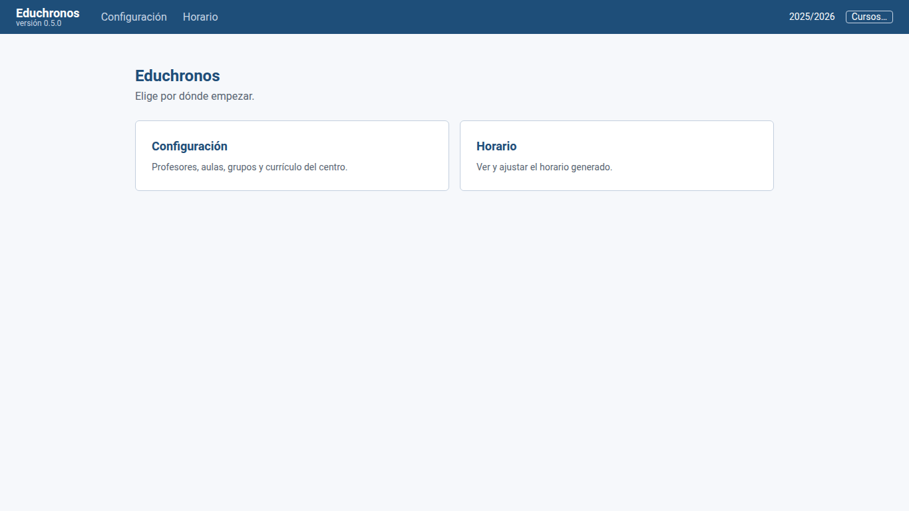

Si vuelves a pulsar el acceso directo con Educhronos ya abierto, no se abre otro: te devuelve a la
pestaña del navegador.

**Atención:** si al abrir sale el aviso
<!-- sin-comprobar -->«No se puede abrir Educhronos: otro programa está usando el puerto 8080. Cierra ese programa y vuelve a intentarlo.»<!-- /sin-comprobar -->,
Educhronos no se abre. Cierra el otro programa o, si no sabes cuál es, avisa.

## Ver qué versión tienes

Debajo de la marca Educhronos, arriba a la izquierda, pone «versión 0.5.0». Es lo primero que
tienes que decir si avisas de un fallo.

## Cerrar

Educhronos se cierra desde su icono en la bandeja del sistema, junto al reloj de Windows. Si no lo
ves, pulsa la flecha ^ de la bandeja: puede estar entre los iconos ocultos.

1. Haz clic con el botón derecho en el icono de Educhronos.
2. Elige <!-- sin-comprobar -->«Salir»<!-- /sin-comprobar -->.

El icono desaparece. La pestaña del navegador se queda abierta; puedes cerrarla.

En ese mismo menú, <!-- sin-comprobar -->«Abrir Educhronos»<!-- /sin-comprobar --> te devuelve a la
pestaña del navegador si la has cerrado.

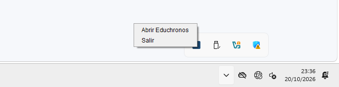

# 4. Cómo está organizada la aplicación

**Para qué sirve.** Para saber dónde está cada cosa.

## La barra de arriba

Siempre está a la vista, en todas las pantallas. De izquierda a derecha:

- **La marca** Educhronos, con la línea «versión 0.5.0» debajo. Si haces clic en la marca, vuelves
  a la portada.
- **«Configuración»**: todo lo que el horario necesita saber del centro.
- **«Horario»**: ver, ajustar y sacar el horario.
- **El curso abierto**, por ejemplo «2025/2026». Todo lo que haces es sobre ese curso.
- **«Cursos…»**: la lista de cursos, para abrir otro o preparar el siguiente (sección 5).

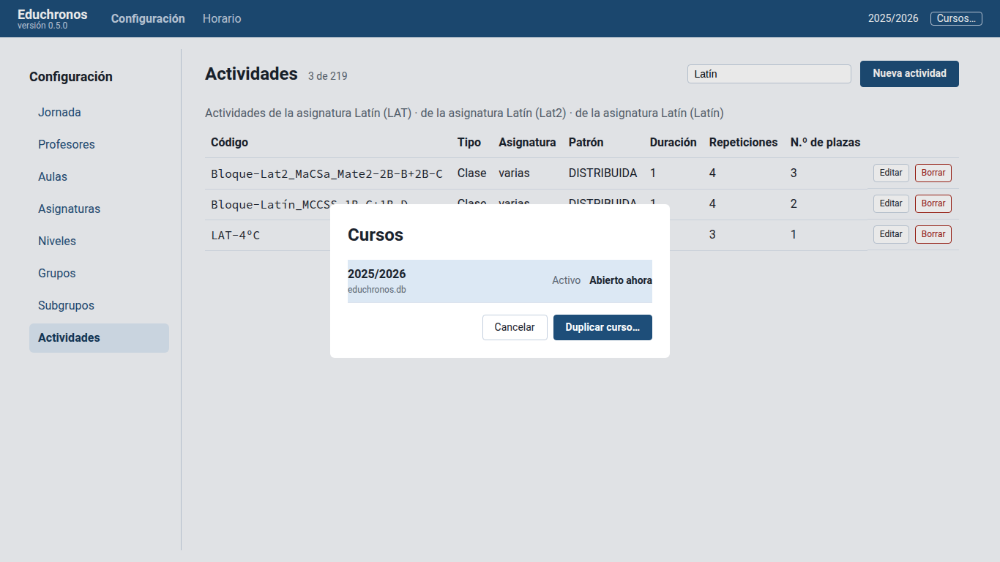

## Los ocho apartados de Configuración

A la izquierda de Configuración hay un índice con ocho apartados, siempre en este orden:

1. «Jornada»: los tramos de un día tipo, con sus horas y el recreo. Se aplica igual de lunes a
   viernes.
2. «Profesores» (sección 6).
3. «Aulas».
4. «Asignaturas».
5. «Niveles».
6. «Grupos»: desde aquí se asigna el tutor de cada grupo (sección 6).
7. «Subgrupos».
8. «Actividades»: las clases de la semana (sección 7).

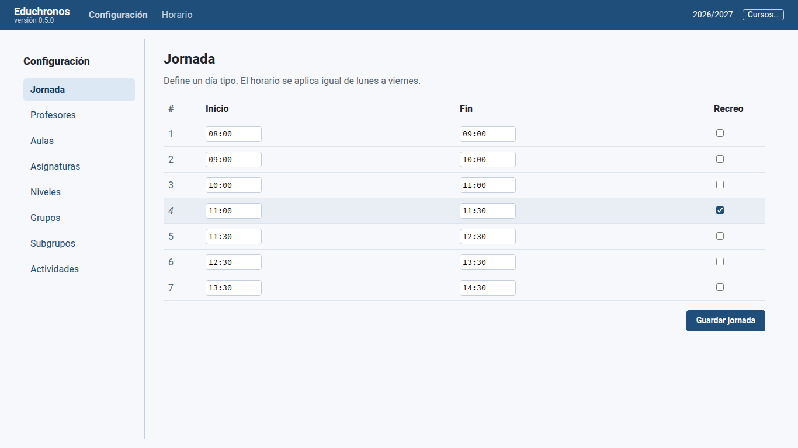

En este manual, a las *actividades* se las llama *clases*. En la aplicación se llaman
«Actividades».

# 5. Preparar el curso nuevo

**Para qué sirve.** Para empezar el curso siguiente con toda la configuración del actual
(profesores, aulas, grupos, clases…) sin volver a escribirla.

**Dónde se hace.** En la barra de arriba, «Cursos…».

1. Pulsa «Cursos…». Sale la lista de cursos.
2. Pulsa «Duplicar curso…». Sale el formulario «Duplicar curso».
3. En «Curso nuevo» escribe el nombre del curso que empieza, con dos años seguidos y una barra:
   «Dos años consecutivos, como 2026/2027.» Normalmente ya viene escrito.
4. Lee las tres consecuencias que enumera la pantalla:
   - «El curso actual queda archivado, en solo lectura.»
   - «El curso nuevo conserva la configuración, sin horarios ni bloqueos.»
   - «Al terminar se abre el curso nuevo.»
5. Pulsa «Duplicar». Si te lo piensas, «Volver» te devuelve a la lista sin hacer nada.

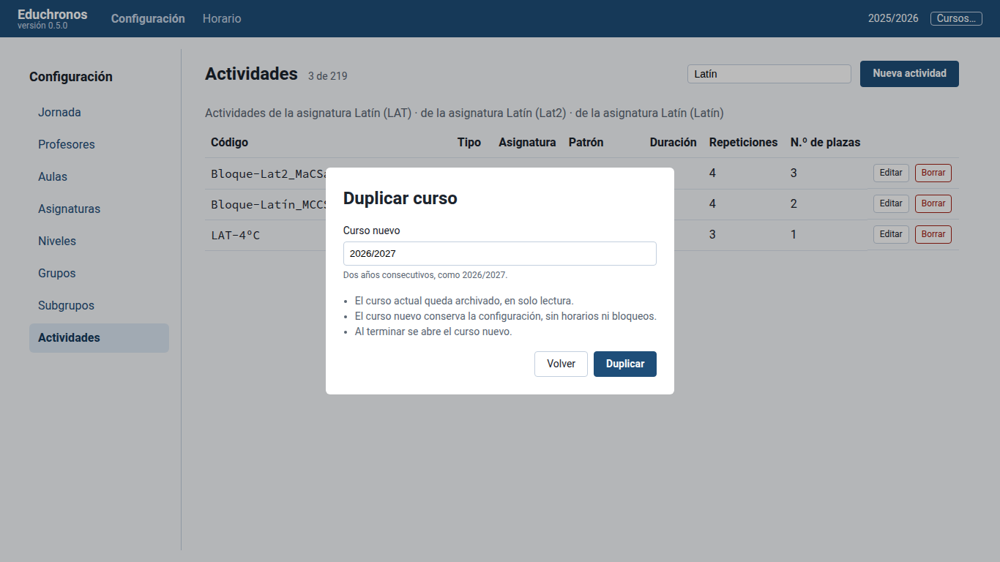

**Qué ves al terminar.** La barra de arriba ya dice el curso nuevo, «2026/2027». El curso nuevo no
tiene horario: lo generarás cuando termines de prepararlo (secciones 8 y 9).

**Atención:** el curso del que partes queda archivado. Lo puedes abrir desde «Cursos…» con
«Abrir» para consultarlo, pero ya no lo puedes cambiar, y no se puede borrar.

# 6. Profesores

**Dónde se hace.** «Configuración» › «Profesores».

La lista enseña, por cada profesor, su «Código», su «Nombre completo», su «Cargo», sus horas y sus
guardias. Cada fila tiene sus botones: «Editar», «Borrar», «Disponibilidad», «Horario» y
«Actividades». Para encontrar a alguien, escribe parte de su código o de su nombre en la caja de
búsqueda, arriba a la derecha.

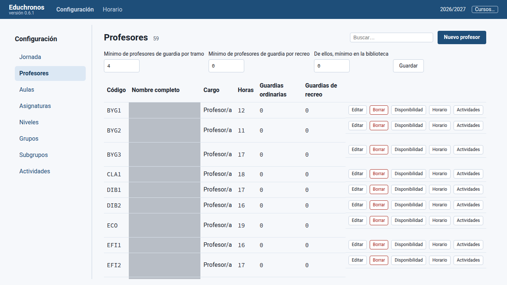

## Dar de alta a un profesor

**Para qué sirve.** Para que el profesor pueda tener clases, guardias o una tutoría.

1. Pulsa «Nuevo profesor».
2. Rellena «Código» (corto, por ejemplo BYG4) y «Nombre completo». Son obligatorios.
3. Si lo sabes, rellena «Horas de clase declaradas», «Guardias ordinarias», «Guardias de recreo» y
   «Cargo».
4. Pulsa «Guardar».

**Qué ves al terminar.** El profesor nuevo aparece en la lista.

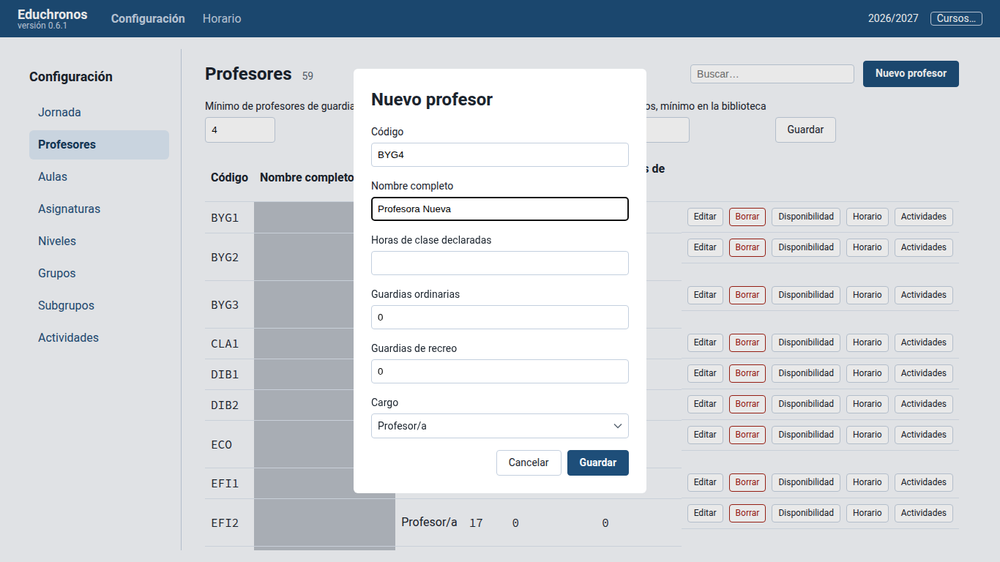

## Cambiar sus datos y sus guardias

1. Busca al profesor y pulsa «Editar» en su fila.
2. Cambia lo que haga falta. Las guardias se escriben aquí, con un número: «Guardias ordinarias» y
   «Guardias de recreo».
3. Pulsa «Guardar».

Los mínimos de guardia del centro están encima de la tabla: «Mínimo de profesores de guardia por
tramo», «Mínimo de profesores de guardia por recreo» y «De ellos, mínimo en la biblioteca». Se
guardan con su propio botón «Guardar», a la derecha.

## Indicar cuándo no puede o prefiere no dar clase

**Para qué sirve.** Para que el horario respete las horas en que un profesor no puede estar (una
reducción, por ejemplo) y, si es posible, las que prefiere no tener.

1. Pulsa «Disponibilidad» en la fila del profesor. Sale una rejilla con los días y los tramos.
2. Elige el «Pincel»: «Disponible», «Prefiere no» o «No puede».
3. Pulsa las casillas que quieras pintar. Si pulsas el nombre de un día, se pinta el día entero; si
   pulsas la hora de un tramo, se pinta ese tramo todos los días.
4. Pulsa «Guardar».

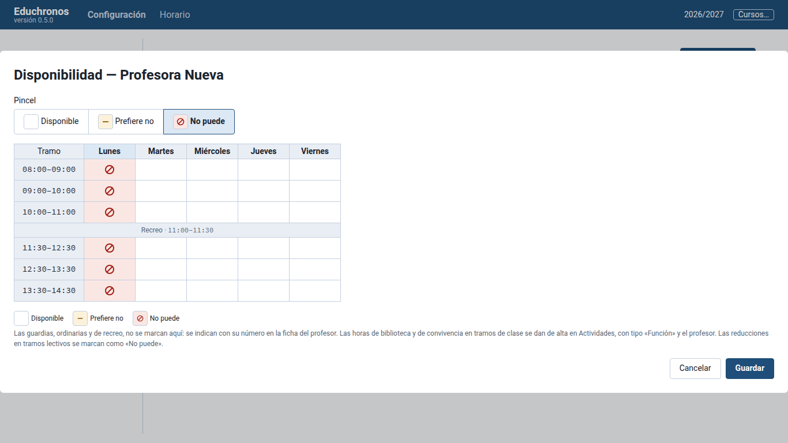

La pantalla lo recuerda debajo de la rejilla: «Las guardias, ordinarias y de recreo, no se marcan
aquí: se indican con su número en la ficha del profesor.» Y también: «Las reducciones en tramos
lectivos se marcan como «No puede».»

## Asignar el tutor de un grupo

**Dónde se hace.** «Configuración» › «Grupos».

1. Pulsa «Tutoría» en la fila del grupo. Sale la ventana, por ejemplo «Tutoría de 4ºC».
2. En «Tutor principal», elige al profesor. Para quitar el tutor, elige «— sin tutor —».
3. Pulsa «Guardar».

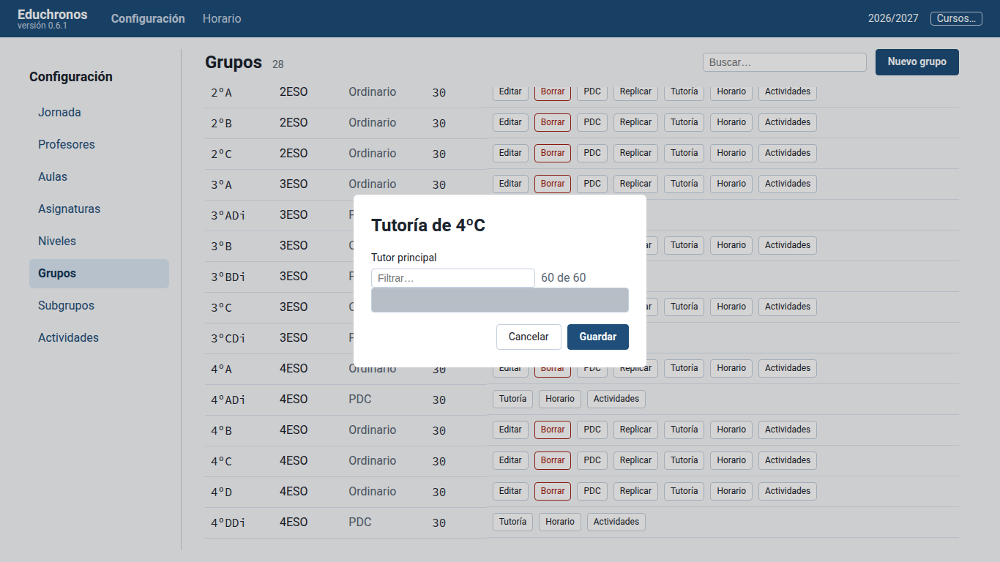

## Dar de baja a un profesor: primero sus clases, después él

Un profesor que tiene clases no se puede borrar directamente. Si lo intentas con «Borrar», la
lista lo rechaza y dice qué clases lo tienen: «No se puede borrar: referenciada por 4 plaza(s).»
y «Para poder borrar, cambia o borra antes lo que se indica y vuelve a intentarlo.»

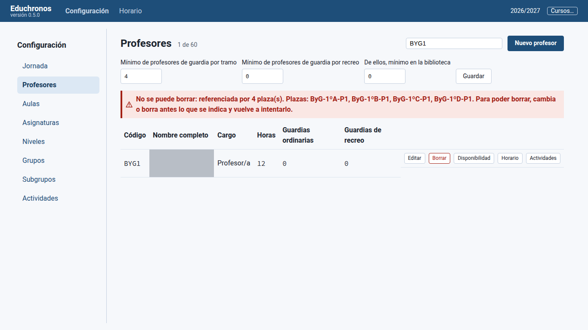

**Paso 1: pasa sus clases a otro profesor.** Si el que lo sustituye es nuevo, dalo de alta antes.

1. En la fila del profesor que se va, pulsa «Actividades». Se abren sus clases; debajo de la caja
   de búsqueda pone, por ejemplo, «Actividades del profesor BYG1».
2. Pulsa «Editar» en una de ellas.
3. En «Profesores», haz clic en el que se va, en la lista «Elegidos», y pulsa «Quitar ›».
4. Haz clic en el que lo sustituye, en la lista «Disponibles», y pulsa «‹ Añadir».
5. Pulsa «Guardar». La clase desaparece de la lista, porque ya no es suya, y la pantalla lo dice:
   «Actividad «ByG-1ºA» guardada. No aparece en la lista porque no corresponde a «BYG1».»
6. Repite con cada clase hasta que no quede ninguna: «Ningún resultado para «BYG1».»

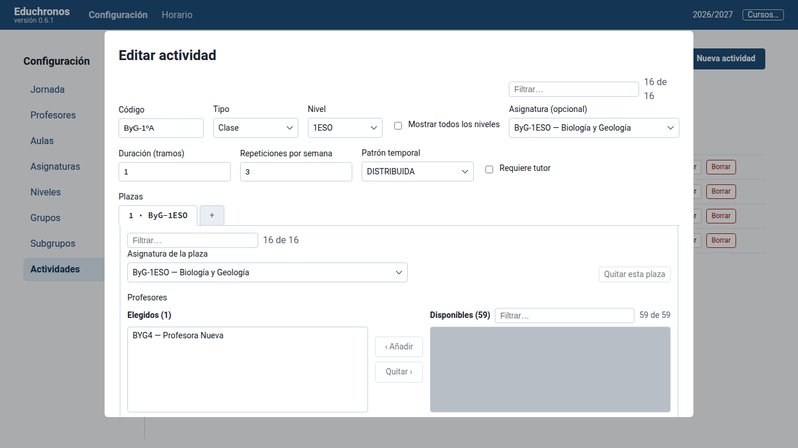

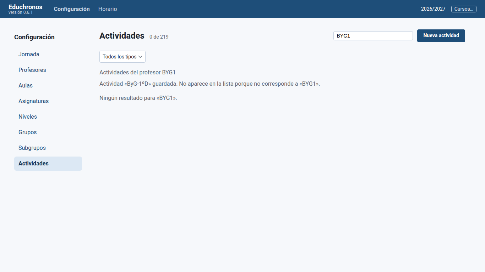

**Paso 2: bórralo.**

1. Vuelve a «Profesores» y busca al profesor que se va.
2. Pulsa «Borrar» y confirma con «Borrar».

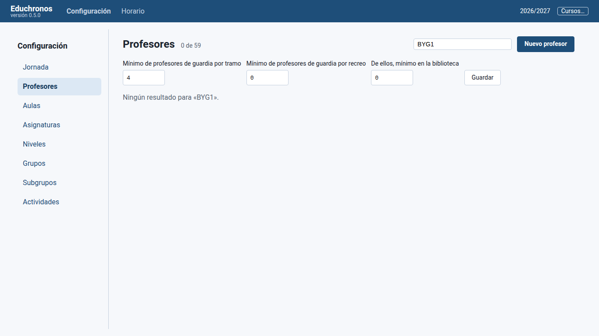

**Atención:** si solo haces el paso 1, el profesor sigue en la lista, aunque ya no tenga clases.
La baja no está hecha hasta que lo borras.

# 7. Clases

**Dónde se hace.** «Configuración» › «Actividades». Cada fila es una clase: su código, su
asignatura, sus «Repeticiones» a la semana y cuántas plazas tiene.

## Encontrar las clases de un grupo o de una asignatura

Escribe en la caja de búsqueda, arriba a la derecha:

- **El código de un grupo**, por ejemplo 4ºC. Debajo de la caja sale «Actividades del grupo 4ºC» y
  la lista enseña solo sus clases.
- **El código o el nombre de una asignatura**, por ejemplo Latín. Sale «Actividades de la
  asignatura Latín (LAT)», y las de otras asignaturas que se llamen igual.
- **El código de un profesor**, como en la sección 6.

Si lo que escribes no es exactamente un código o un nombre, la lista enseña las clases que lo
contienen en alguna de sus columnas.

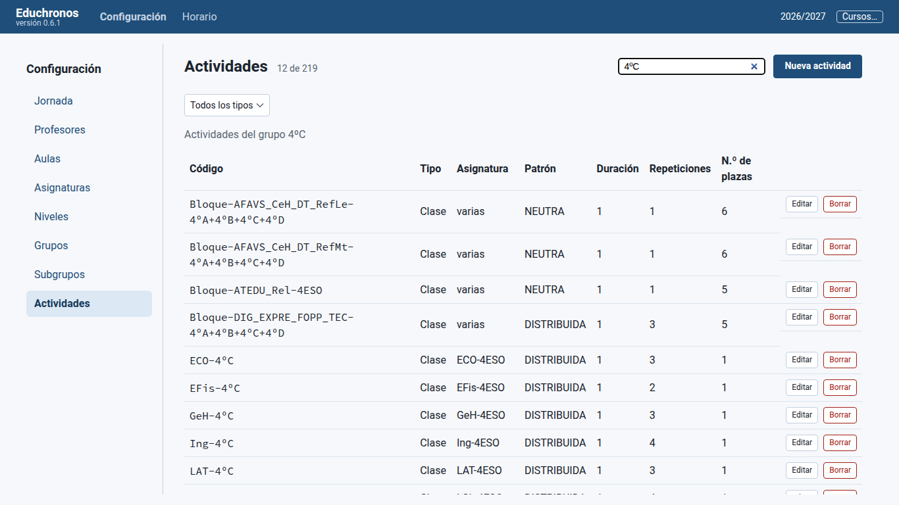

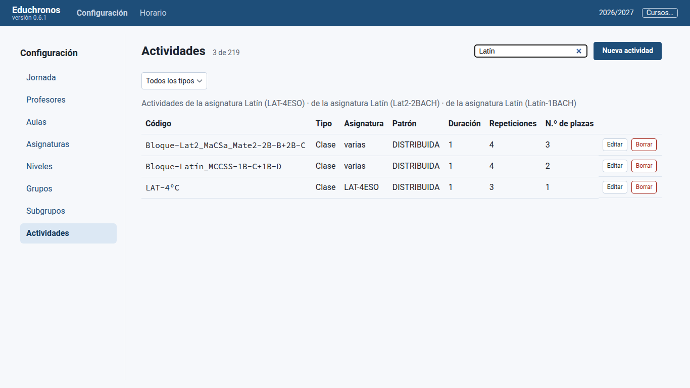

## Cambiar las horas a la semana, el profesor o el aula

1. Pulsa «Editar» en la fila de la clase. Sale «Editar actividad».
2. Cambia lo que haga falta:
   - **Las horas a la semana**: «Repeticiones por semana». «Duración (tramos)» es cuántos tramos
     seguidos dura cada vez.
   - **El profesor**: en «Profesores», con «Quitar ›» y «‹ Añadir», como en la sección 6.
   - **El aula**: en «Aula», con «Fija» eliges una en «Aula fija»; con «Candidatas», varias para
     que el generador escoja; con «La elige el generador», ninguna.
3. Pulsa «Guardar».

Si la clase tiene varias plazas (varios profesores o varias aulas a la vez), cada una tiene su
pestaña bajo «Plazas».

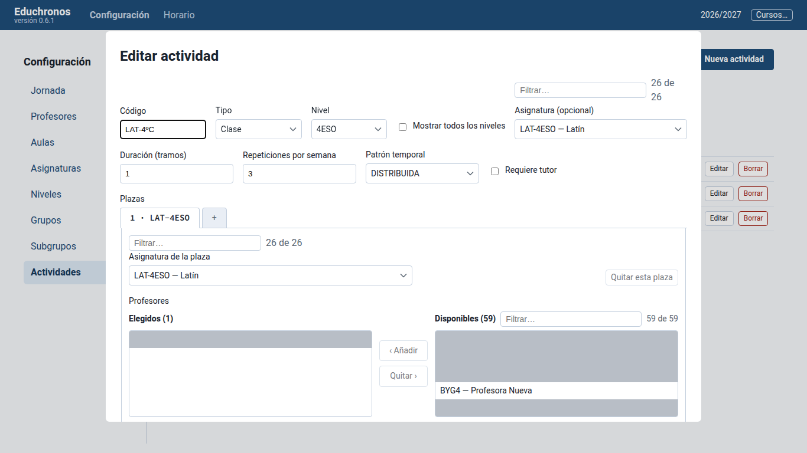

**Atención:** en un curso con horario generado, las clases no se pueden cambiar (sección 9).

# 8. Antes de generar: el panel de pre-validación

**Para qué sirve.** Antes de generar, Educhronos revisa la configuración y avisa de lo que impediría
encontrar un horario. Así lo corriges antes de esperar minutos para nada.

**Dónde se ve.** En «Horario», encima de la rejilla (o del aviso «Este curso todavía no tiene
horario. Créalo con «Generar horario».» si el curso aún no tiene horario).

**Qué dice.** Arriba, dos números: los «errores» y los «otros hallazgos». Con «Ocultar detalle» y
su contrario lo pliegas o despliegas. Cada línea dice su gravedad (ERROR u otra), qué regla falla,
a quién afecta y una frase que explica qué pasa y qué hacer.

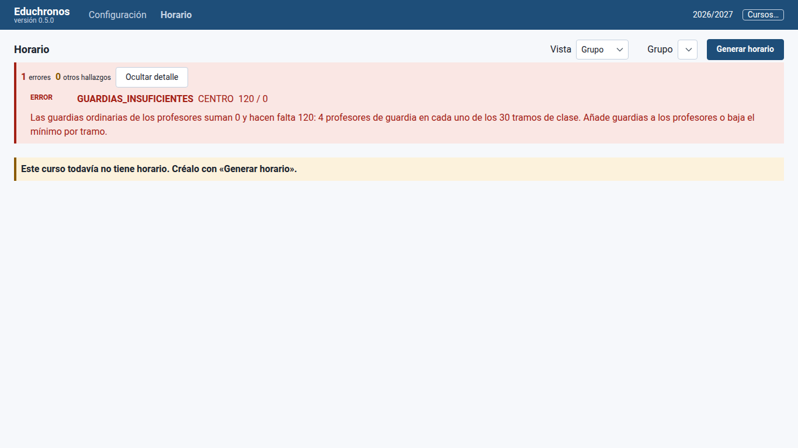

**Qué hacer con un error.** Lee la frase de la línea y corrige lo que dice. Un ejemplo real, el que
da la base de partida: la línea de guardias dice «Añade guardias a los profesores o baja el mínimo
por tramo.» Para corregirlo, en «Configuración» › «Profesores», escribe las «Guardias ordinarias»
de cada profesor (sección 6) o baja el «Mínimo de profesores de guardia por tramo». Al volver a
«Horario», el panel se actualiza.

Los hallazgos que no son ERROR no impiden generar, pero conviene leerlos.

**Atención:** con un ERROR en el panel, la generación no sale. La ventana de confirmación lo dice
(«Además, el servidor rechazará esta generación.») y su botón cambia a «Generar de todos modos».
Corrige antes los errores.

# 9. Generar el horario

**Para qué sirve.** Para que Educhronos busque un horario que cumpla toda la configuración.

**Dónde se hace.** En «Horario», con el botón «Generar horario».

1. Comprueba que la configuración está terminada y que el panel de pre-validación no tiene errores
   (sección 8).
2. Pulsa «Generar horario». Sale la ventana «Confirmar la generación».
3. En «Tiempo de cálculo», elige «10 minutos», «20 minutos», «30 minutos» o «60 minutos». Con más
   tiempo es más probable que salga y que respete mejor las preferencias.
4. Lee las consecuencias: «Tarda hasta 10 minutos.» (o los que hayas elegido), «Sustituye el
   horario en el que estás trabajando.» y «No se puede deshacer.»
5. Pulsa «Generar horario» en la ventana, o «Cancelar» para no hacer nada.

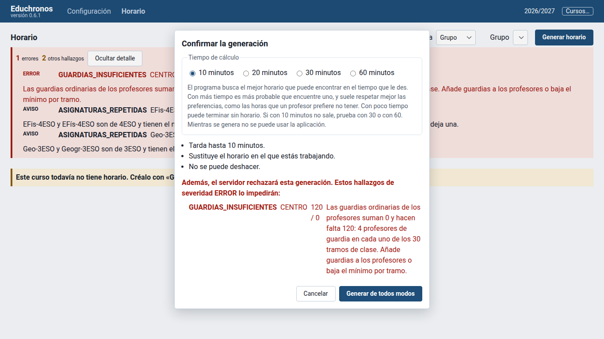

**Qué ves mientras genera.** Una ventana con una barra que avanza y el tiempo que lleva. Como dice
la ventana anterior: «Mientras se genera no se puede usar la aplicación.» Espera a que termine.

**Qué ves al terminar.** El horario, en la rejilla de «Horario» (sección 10).

**Si termina sin horario.** Vuelve a generar con más tiempo. La propia ventana lo aconseja: «Si con
10 minutos no sale, prueba con 30 o con 60.» Si tampoco sale, revisa el panel de pre-validación.

**Atención:** después de generar, las clases y la jornada de ese curso ya no se pueden cambiar. Si
lo intentas, la ficha de la clase lo rechaza con un aviso en rojo: «No se puede editar: referenciada
por 3 sesion(es)». Genera cuando la configuración esté terminada. Si aun así tienes que cambiar
algo, sigue la sección 11.

**Atención:** el aviso termina diciendo «Borra el horario generado y los bloqueos que dependen de
ella antes de editarla.», pero Educhronos no tiene ninguna forma de borrar un horario. Lo que sí
funciona es duplicar el curso: lo explica la sección 11.

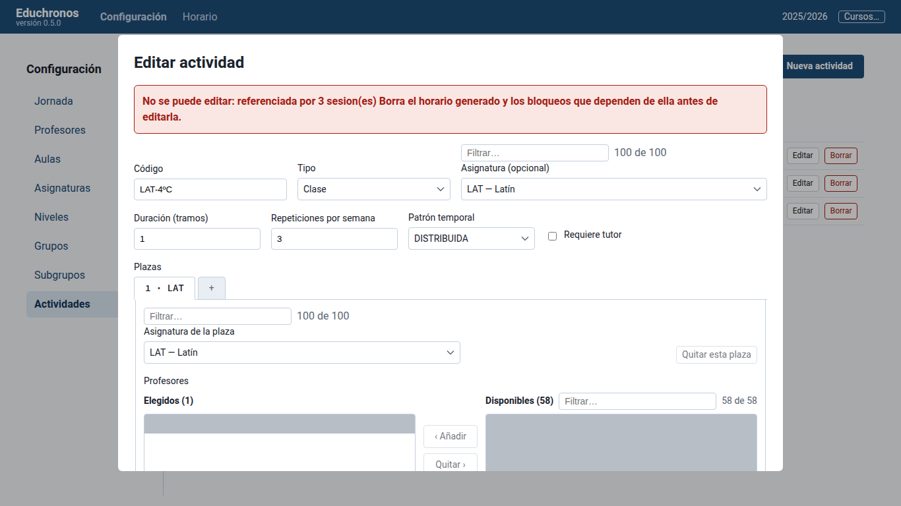

# 10. Ver y ajustar el horario

**Dónde se hace.** «Horario».

## Ver el horario de un grupo, un profesor o un aula

1. En «Vista», elige «Grupo», «Profesor», «Aula» o «Guardias».
2. Al lado, elige qué grupo, qué profesor o qué aula. La caja que hay delante sirve para filtrar esa
   lista si es muy larga.

La rejilla tiene los días en columnas y los tramos en filas. Cada clase dice su asignatura, su aula
y su profesor. Cuando en un tramo hay varias clases a la vez, la celda lo dice arriba (por ejemplo,
4 simultáneas). Desde «Profesores» y «Grupos» también puedes llegar aquí con el botón «Horario» de
cada fila.

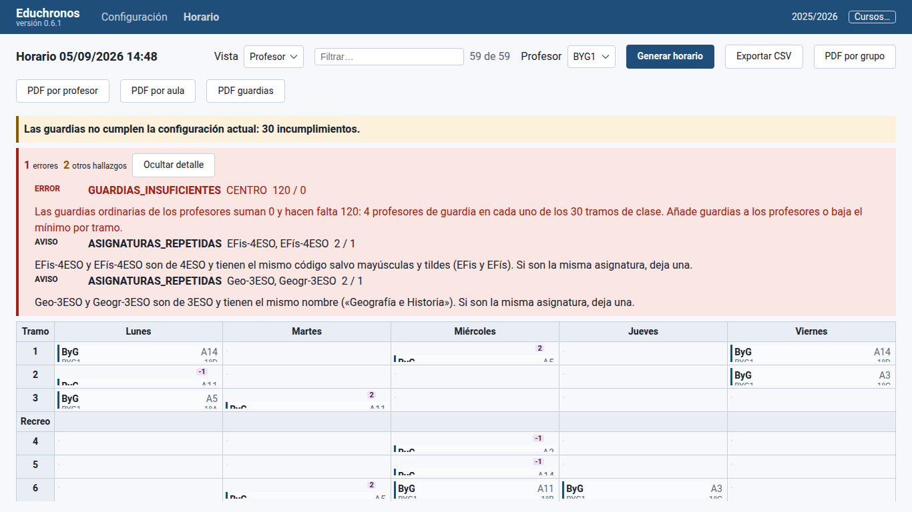

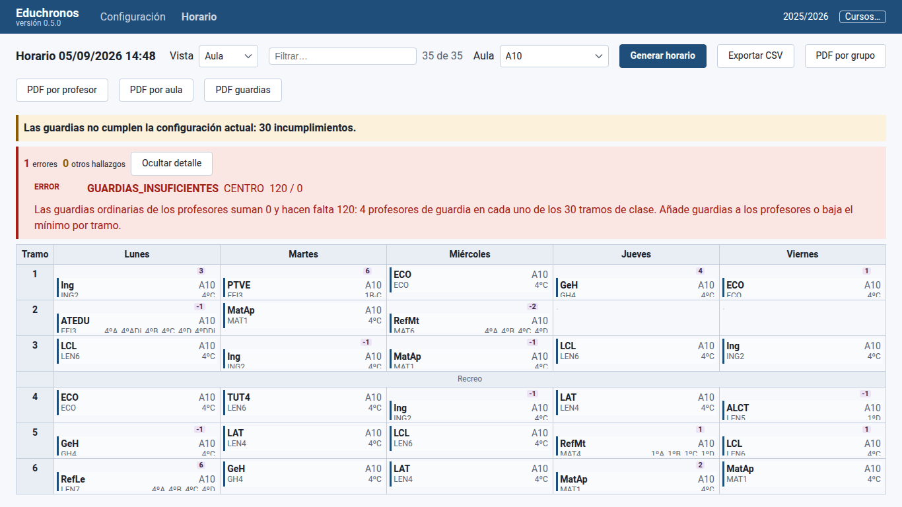

## Mover una clase

Arrastra la clase con el ratón y suéltala en otra celda.

- Si la celda está libre, la clase se mueve allí.
- Si en la celda hay otra clase, las dos se intercambian.
- Si en la celda hay dos clases o más, la clase no se mueve: la pantalla avisa de que no sabe con
  cuál intercambiarla.
- Si el cambio choca con algo (un profesor que ya tiene clase a esa hora, un aula ocupada…), la
  clase no se mueve y sale un aviso en rojo con lo que choca.

## Fijar una clase con el candado antes de volver a generar

Cada clase tiene un candado pequeño en su esquina. Abierto, la clase está libre. Si lo pulsas, se
cierra: la clase queda fijada en ese tramo, y cuando vuelvas a generar se respetará. Encima de la
rejilla aparece un aviso que cuenta las clases fijadas, por ejemplo «1 pines sin aplicar —
regenerar». Para quitarlo, vuelve a pulsar el candado.

Una clase con el candado cerrado no se puede arrastrar: quita antes el candado.

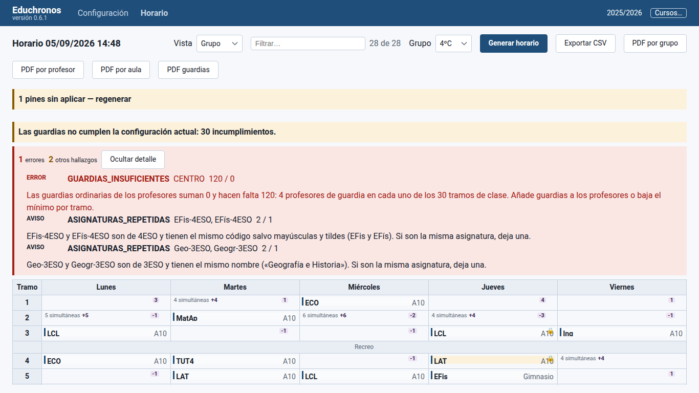

# 11. Si necesitas cambiar clases después de generar

**Para qué sirve.** Para cambiar clases, profesores de una clase o la jornada cuando el curso ya
tiene horario.

**Por qué no se puede directamente.** Generar fija las clases y la jornada de ese curso (sección 9).
La salida es trabajar sobre una copia del curso, que no tiene horario.

1. Abre el curso que quieres cambiar (barra de arriba, «Cursos…»).
2. Duplícalo como en la sección 5. El nombre del curso nuevo no puede ser el de un curso que ya
   exista, y tiene que tener la forma de dos años seguidos.
3. La copia se abre sola. No tiene horario y sus clases se pueden cambiar: haz los cambios
   (secciones 6 y 7).
4. Vuelve a generar el horario (secciones 8 y 9).

**El coste, dicho tal cual.** El curso del que partes queda archivado y no se puede borrar. Cada
vez que hagas esto, la lista de «Cursos…» tendrá un curso más.

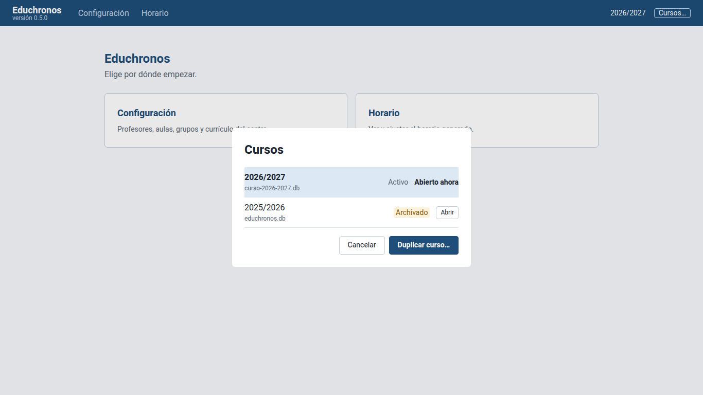

# 12. Sacar los horarios

**Para qué sirve.** Para tener el horario en papel o en un fichero.

**Dónde se hace.** En «Horario», con los botones de arriba. Solo salen cuando el curso tiene
horario.

- «Exportar CSV»: todas las clases del horario en un fichero de texto por columnas, que se abre con
  una hoja de cálculo.
- «PDF por grupo», «PDF por profesor» y «PDF por aula»: el horario de cada grupo, de cada profesor
  o de cada aula.
- «PDF guardias»: las guardias.

Cada botón descarga un fichero. El navegador lo guarda en su carpeta de descargas (normalmente,
Descargas).

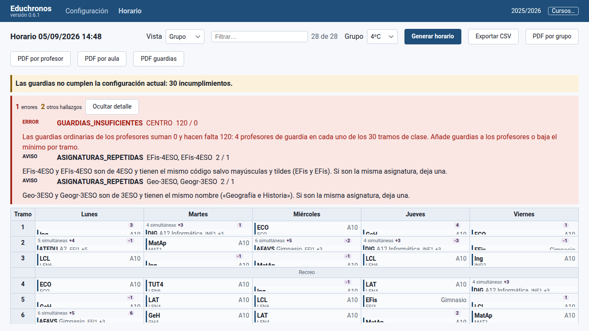

# Anexo: la primera vez que se abre el navegador

La primera vez que se usa el navegador en un ordenador, antes de enseñar Educhronos puede salir su
pantalla de bienvenida, por encima de la portada. En un ordenador con Windows 11 es la de Microsoft
Edge: <!-- sin-comprobar -->«Le damos la bienvenida a Microsoft Edge, el explorador recomendado en Windows»<!-- /sin-comprobar -->.

1. Pulsa <!-- sin-comprobar -->«Comience sin sus datos»<!-- /sin-comprobar -->.
2. Si salen más pantallas del navegador, elige en cada una la opción que no inicia sesión ni
   comparte datos.
3. Al terminar ves la portada de Educhronos. Si el navegador ha abierto otras pestañas suyas,
   puedes cerrarlas.

<!-- Manual de uso de Educhronos 0.5.0 (S242, O-manual, C-alcance-manual). Las citas entre
     comillas angulares las comprueba tools/manual/capturas.mjs contra la aplicación; las de Windows,
     la ventana de arranque, la bandeja e Instalar.cmd van entre las marcas sin-comprobar. La
     sección 13, Si algo no va bien, es docs/guia-incidencias.md, que tools/manual/generar-pdf.sh
     añade al final. -->
